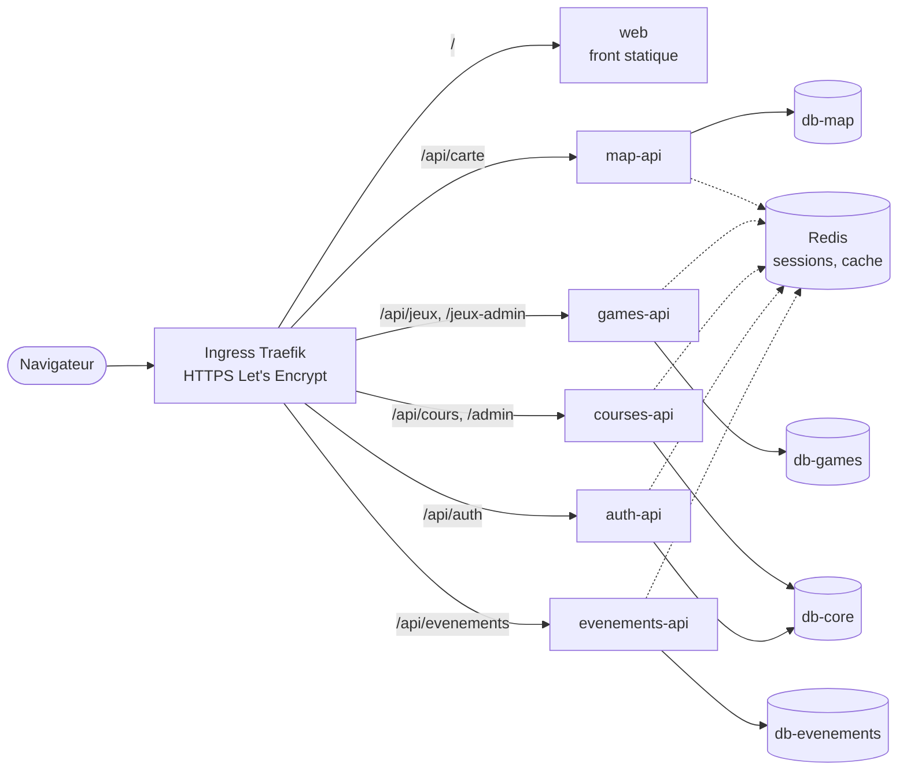

# Composmart

**Plateforme web de sensibilisation au compostage, en production sur
[composmart.fr](https://composmart.fr).**

Conçue, développée et exploitée de bout en bout par **Eliott Seuret** :
fonctionnalités, architecture, infrastructure, sécurité et conformité RGPD.

> **English summary** — Composmart is a production web platform promoting
> composting: an interactive map of ~6,000 composting sites across France,
> courses with quizzes, mini-games with leaderboards, and live in-person
> workshops joined by QR code. It runs as six PHP microservices with four
> MariaDB databases and Redis on a self-managed Kubernetes (k3s) cluster,
> deployed through a custom Helm chart. Designed, built and operated
> end-to-end by Eliott Seuret.

## Fonctionnalités

- **Carte interactive** de ~6 000 composteurs en France, alimentée chaque nuit
  par OpenStreetMap et par l'open data de collectivités ; les utilisateurs
  proposent des ajouts et signalent des erreurs, validés par un administrateur.
- **Cours et quiz** sur le compostage, avec progression, points d'expérience et
  niveaux ; contenu éditable depuis un back-office.
- **Mini-jeux** et classements ; contenu et règles de chaque jeu éditables
  depuis le back-office, avec historique des versions.
- **Ateliers en présentiel** : les participants rejoignent une session par code
  ou QR code, forment des équipes et répondent à un parcours de questions
  piloté en direct par l'animateur.
- **Espace personnel** : progression, badges, suivi des demandes, export et
  suppression de ses données.

## Points techniques notables

- **Architecture en microservices** — six services indépendants, une base de
  données par domaine. Une charge ou une panne sur la carte n'affecte ni les
  cours ni un atelier en cours. Les services échangent par des appels internes
  authentifiés (crédit d'XP, journal d'audit, suppression et export des
  données d'un compte sur toutes les bases).
- **Kubernetes en production** — cluster k3s auto-hébergé, chart Helm écrit
  pour le projet. Un déploiement se fait en une commande : seuls les services
  dont le code a changé sont reconstruits (dépendances lues dans les
  Dockerfile), les migrations SQL sont appliquées automatiquement et une
  seule fois, et `helm rollback` permet un retour arrière.
- **Performance de la carte** — chargement limité à la zone visible, index
  géographique en base, cache Redis invalidé à chaque écriture.
- **Sécurité** — protection CSRF, limitation des abus, sessions côté serveur
  partagées via Redis, requêtes préparées, contrôle des droits côté serveur,
  journal d'audit des actions d'administration, pages d'administration
  indiscernables d'une page inexistante pour un non-administrateur.
- **Conformité RGPD** — aucun traceur ni service tiers chargé sans action de
  l'utilisateur (bibliothèques et polices hébergées localement, vidéos au
  clic), donc aucun bandeau cookies nécessaire ; durées de conservation
  appliquées par des tâches planifiées ; export et suppression des données en
  libre-service.

## Architecture



| Service | Rôle | Base |
|---|---|---|
| **web** | Interface (HTML, CSS, JavaScript, Leaflet) | — |
| **map-api** | Composteurs, propositions, signalements | db-map |
| **games-api** | Mini-jeux : contenu, règles, scores, back-office | db-games |
| **courses-api** | Cours, quiz, contact, back-office | db-core |
| **auth-api** | Comptes, authentification, profil, classements | db-core |
| **evenements-api** | Ateliers, parcours de questions, suivi en direct | db-evenements |

Tâches planifiées : import OpenStreetMap nocturne, purges RGPD
(`services/*/cron/`).

## Stack

| Domaine | Technologies |
|---|---|
| Back-end | PHP 8.3, Apache |
| Données | MariaDB 11 (4 bases), Redis 7 |
| Front-end | HTML, CSS, JavaScript sans framework, Leaflet |
| Infrastructure | Docker, Kubernetes (k3s), Helm, Traefik, cert-manager |
| Hébergement | VPS OVHcloud (France) |

## Organisation du dépôt

```
services/      un dossier par service : code PHP, Dockerfile, tâches planifiées
  web/front/   pages, styles, scripts et bibliothèques hébergées localement
shared/        code commun aux services (sécurité, sessions, emails) et scripts d'import
db/            schémas des bases et migrations
content/       contenu initial des cours
helm/          chart Helm et script de déploiement
docs/          notes de développement et d'exploitation
```

## Déploiement

```bash
bash helm/deploy.sh
```

Détails, installation sur un serveur neuf et test local : [helm/README.md](helm/README.md).
Conventions de développement : [docs/developpement.md](docs/developpement.md).

## Licence

© 2026 Eliott Seuret — **tous droits réservés**. Ce dépôt est public à titre
de présentation : il peut être consulté librement, mais toute réutilisation
du code ou des contenus demande une autorisation écrite (voir
[LICENSE](LICENSE)). Les bibliothèques, polices et données de tiers restent
sous leur propre licence ([THIRD_PARTY_NOTICES.md](THIRD_PARTY_NOTICES.md)).

Contact : [contact@composmart.fr](mailto:contact@composmart.fr)
